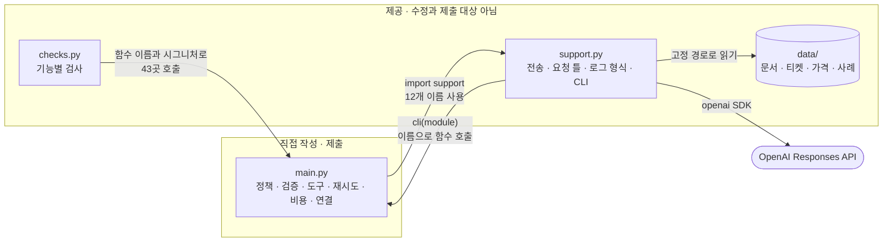
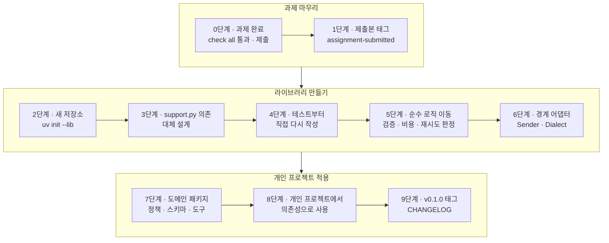
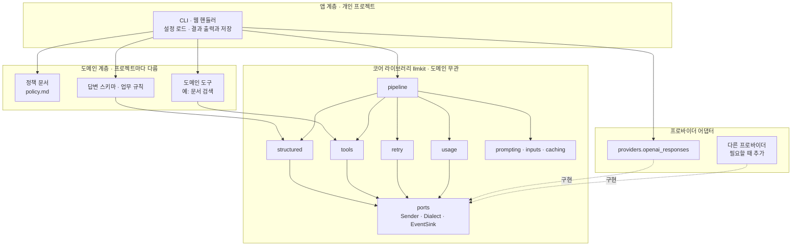
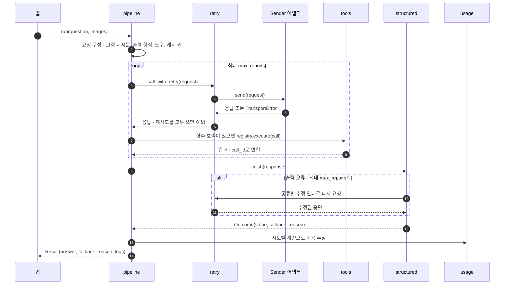

# 과제 결과물을 개인 프로젝트로 옮기는 방법

> 대상: `kant-next-prompt-student`(DevDesk 과제)를 마친 뒤 그 결과물을 개인 프로젝트에서 다시 쓰려는 경우
> 작성: 2026-10-21, Claude Opus 5.5 (`kant-next-prompt-student/AI_USAGE.md`에 기록)

## 0. 읽기 전에

- **다루는 것**: 모듈 경계, 라이브러리화 전략, 주의할 점, 결과물의 구조, 인터페이스 예시.
- **다루지 않는 것**: 과제 `_todo(...)` 빈칸의 구현, 정책 프롬프트 문장, 답변과 도구의 JSON Schema 내용. 과제의 AI 사용 기준(`AI_USAGE.md`)이 금지하는 범위라서, 예시 코드에서 해당 자리는 `raise NotImplementedError`와 `# 과제 ...를 옮겨 옵니다` 주석으로 비워 두었습니다. 직접 작성한 과제 코드를 일반화해 그 자리에 옮기면 됩니다.
- **코드 스타일**: 모든 예시는 [Google Python Style Guide](https://google.github.io/styleguide/pyguide.html)를 따르고, Google이 배포하는 [pylintrc](https://raw.githubusercontent.com/google/styleguide/gh-pages/pylintrc)와 pylint 4.1.3으로 검사해 경고 0건을 확인했습니다. 검사 방법은 [4.9절](#49-lint와-포맷-설정)에 있습니다.
- 라이브러리 이름 `llmkit`, 개인 프로젝트 이름 `wiki_helper`(사내 위키 문의 도우미)는 설명을 위한 가칭입니다.

## 1. 전략 개요

### 1.1 한 문장 요약

**과제는 원래 모양 그대로 끝내 제출하고, 그 뒤 별도 저장소에서 "도메인을 모르는 코어 라이브러리 + 프로젝트별 도메인 패키지 + 앱"의 세 층으로 다시 조립합니다.**

### 1.2 현재 구조 진단

과제 코드는 "한 파일의 빈칸 채우기"에 맞춰 설계되어 있어서, 그대로 떼어 쓰기 어렵게 서로 묶여 있습니다.



| 결합 지점 | 내용 | 옮길 때 생기는 문제 |
|---|---|---|
| main.py → support.py | `TransportError`, `base_request`, `has_refusal`, `validation_detail`, `append_repair_input`, `append_attempt`, `delay_for`, `validate_usage_counters`, `pack_usage_record`, `image_url`, `load_prices`, `cli`의 12개 이름 사용 | support.py 없이는 import부터 실패합니다. support.py는 제공 코드라 그대로 가져가면 안 됩니다([2.2절](#22-제공-코드와-데이터의-권리와-범위)). |
| checks.py → main.py | 함수 이름과 인자 순서로 43곳 호출 | 과제 기간에 main.py 구조를 바꾸면 검사와 채점이 깨집니다. |
| support.py → data/ | `ROOT / "data"` 고정 경로, `MODEL = "gpt-5.6-luna"` 상수 | 다른 프로젝트에서 경로와 모델을 바꿀 수 없습니다. |
| 도메인 값이 로직에 섞임 | `lookup_ticket`, `IT-[0-9]{4}`, 카테고리 4종, `doc_id`, `kant-next-pe-` 캐시 키 | 도메인을 바꿀 때 로직까지 고쳐야 합니다. |
| 오류 종류를 문자열로 전달 | `validate_answer`가 `ValueError("blank answer")`를 올리면 `support.validation_detail`이 메시지 문자열로 종류를 판별 | 메시지 한 글자만 바뀌어도 분류가 조용히 틀어집니다. |

### 1.3 재사용 가치가 있는 패턴

과제의 기능 하나하나는 DevDesk 전용이지만, 그 밑의 패턴은 대부분의 LLM 앱에서 다시 쓰입니다.

| 과제 기능 | 일반화한 능력 | 개인 프로젝트에서의 쓰임 |
|---|---|---|
| 정책 프롬프트 (`build_instructions`) | 정책과 참고 문서를 결정적인 순서로 직렬화한 고정 지시문 | 근거 문서 기반 답변이 필요한 모든 도메인 |
| 답변 검증과 수정 (`answer_format`, `validate_answer`, `finish_answer`) | 구조화 출력: 스키마 → 업무 규칙 → 종류별 수정 1회 → 대체 값 | JSON을 받는 모든 기능(분류, 추출, 요약 카드) |
| 티켓 조회 (`tool_schema`, `execute_tool`, `tool_roundtrip`) | 도구 등록부와 함수 호출 왕복 루프(`call_id` 연결, 라운드 상한) | 검색, DB 조회, 내부 API 조회 |
| 오류 화면 입력 (`image_content`) | 텍스트와 이미지 입력 조립 | 스크린샷, 문서 사진 질의 |
| 호출 재시도 (`call_with_retry`) | 오류 분류 기반 재시도, 지수 백오프, 상한 | 모든 외부 API 호출 |
| 사용량과 비용 (`cache_settings`, `usage_record`) | 캐시 키 설계, 토큰 계량 정규화, 비용 추정 | 비용 대시보드, 예산 경보 |
| 전체 연결 (`run_pipeline`) | 구성 요소를 주입받는 파이프라인 | 앱의 요청 처리 핵심 |
| 선택 심화 (`audit_audience_pair`) | 변형 사이의 정책 필드 일관성 감사 | 대상, 언어, 말투를 바꾼 프롬프트의 회귀 검사 |
| 제공 `compare`, `checks.py` | 사례 기반 A/B 비교, 고정 응답 재생 테스트 | 프롬프트 변경 회귀 평가(직접 다시 작성) |

### 1.4 여섯 가지 원칙

1. **제출물과 라이브러리를 분리합니다.** main.py는 끝까지 과제 형식을 지키고, 라이브러리는 제출 뒤 새 저장소에서 만듭니다.
2. **코어는 프로바이더도 도메인도 모릅니다.** 코어는 `Sender`(요청 → 응답)와 `Dialect`(응답 해석) 프로토콜에만 의존합니다. `openai` import는 어댑터 한 곳에만 둡니다.
3. **도메인 값은 데이터로 주입합니다.** 정책 문장, 스키마, 업무 규칙, 도구, 가격표는 인자나 설정 파일로 받습니다.
4. **오류 종류는 문자열이 아니라 타입으로 전달합니다.** `OutputValidationError(kind=...)`처럼 예외 속성으로 분기합니다.
5. **부작용은 주입합니다.** 전송(`send`), 대기(`sleep`), 시계(`clock`), 난수(`rng`), 기록(`sink`)을 인자로 받아 테스트에서 바꿀 수 있게 합니다. 과제의 `send`, `sleep` 인자가 이미 이 방식입니다.
6. **라이브러리는 `print`, `sys.exit`, 파일 쓰기를 하지 않습니다.** 결과는 반환값과 예외로, 관측은 `logging`과 이벤트로 남기고, 출력과 저장은 앱이 맡습니다.

### 1.5 진행 순서



| 단계 | 할 일 | 끝났다는 기준 |
|---|---|---|
| 0 | 과제를 원래 구조로 완성 | `check all` 전체 통과, `compare --live`와 `export` 실행, 제출 |
| 1 | 제출본을 git 태그로 고정 | `git tag assignment-submitted`. 이후 동작 비교의 기준점 |
| 2 | 새 저장소 생성 | `uv init --lib llmkit`으로 `src/llmkit/`과 `py.typed` 생성 |
| 3 | support.py 의존 12개의 대체 설계 | [2.3절](#23-supportpy-의존-끊기) 표의 "대체" 열을 자기 설계로 확정 |
| 4 | 테스트부터 다시 작성 | checks.py 항목의 의도를 참고해 pytest로 직접 작성([4.7절](#47-테스트--fakesender로-네트워크-없이)) |
| 5 | 순수 로직 이동 | 검증 규칙, 비용 계산, 재시도 판정이 네트워크 없이 테스트 통과 |
| 6 | 경계 어댑터 작성 | `providers/openai_responses.py`의 Sender와 Dialect |
| 7 | 도메인 패키지 작성 | 개인 프로젝트의 정책, 스키마, 도구 |
| 8 | 개인 프로젝트에서 의존성으로 사용 | `uv add`([3.5절](#35-개인-프로젝트에서-가져다-쓰는-방법)) 후 실제 질문 1건을 끝까지 처리 |
| 9 | 버전 고정 | `v0.1.0` 태그와 CHANGELOG |

## 2. 유념하고 주의 깊게 살펴야 할 부분

### 2.1 순서: 과제 먼저, 추출은 제출 뒤

- 제출물은 `main.py`와 `AI_USAGE.md` 두 파일이고, 검사와 채점 환경에는 제공된 `support.py`, `checks.py`만 있습니다. main.py가 `llmkit`을 import하면 그 환경에서 바로 실패합니다.
- checks.py는 함수 이름과 인자 순서로 검사합니다. 과제 기간에 "미리 모듈화"하려고 main.py 함수를 쪼개거나 이름과 시그니처를 바꾸지 마세요.
- 라이브러리 작업 중에 고친 코드를 main.py로 역이식하지 마세요. AI 도움을 받아 만든 라이브러리 코드가 제출물에 섞이면 `AI_USAGE.md`의 기준(직접 작성)과 어긋납니다.

### 2.2 제공 코드와 데이터의 권리와 범위

- `support.py`, `checks.py`, `data/`, `ASSIGNMENT.md`는 과제 제공물입니다. 재사용 허락을 확인하기 전에는 개인 저장소, 특히 공개 저장소에 복사하지 마세요. 같은 역할을 하는 코드를 **직접 다시 작성**하는 편이 안전합니다. 이 문서의 예시도 그렇게 썼습니다.
- `documents.json`, `tickets.json`의 KANT NEXT 정책과 티켓은 과제용 테스트 데이터입니다. 개인 프로젝트에는 자기 도메인의 데이터를 새로 만드세요.
- 개인 저장소에는 본인이 작성한 main.py 구현에서 출발한 코드만 올리고, 과제 문제 설명을 그대로 옮기지 않습니다.

### 2.3 support.py 의존 끊기

| support.py 이름 | 과제에서 하는 일 | 라이브러리에서의 대체 |
|---|---|---|
| `TransportError` | SDK 예외를 단순화한 전송 오류 | `llmkit.errors.TransportError`를 직접 정의([4.2절](#42-errorspy--문자열-대신-타입)) |
| `base_request`, `MODEL` | 요청 틀과 모델 이름 고정 | 어댑터와 설정으로 이동. 모델, `max_output_tokens`, reasoning 설정은 인자 |
| `has_refusal` | 응답의 거절 판별 | `Dialect.has_refusal`. 응답 모양은 프로바이더마다 다릅니다. |
| `validation_detail` | 예외 → (`error_kind`, `field`), 메시지 문자열로 판별 | 올리는 쪽에서 `OutputValidationError.kind`, `field`를 채워 문자열 매핑을 없앱니다. |
| `append_repair_input` | 이전 출력과 수정 지시를 대화에 덧붙이고, 도구가 있으면 `tool_choice="none"` | `structured.finish` 내부나 Dialect 메서드. `tool_choice` 같은 필드는 프로바이더 전용입니다. |
| `append_attempt` | 시도 결과를 이벤트로 기록 | `EventSink.emit` |
| `delay_for` | 지터를 섞은 지수 백오프 | `RetryPolicy.delay_for(attempt, rng)`. rng를 주입해 테스트를 결정적으로 만듭니다. |
| `validate_usage_counters` | 계량의 자료형과 모순 검사 | `usage` 모듈의 검증 함수 |
| `pack_usage_record` | 정해진 로그 형식으로 포장 | `usage` 모듈의 dataclass 기록(dict 대신 타입) |
| `image_url` | PNG → data URL | `inputs` 모듈. PNG만 받는 제약을 MIME 인자로 일반화 |
| `load_prices` | `data/prices.json` 고정 경로 | `usage.Pricing.from_json(path)` |
| `cli`, `stage_result`, `run_comparison` 등 | 과제용 실행기 | 앱 계층(개인 프로젝트의 CLI와 평가 스크립트) |

### 2.4 하드코딩된 값을 인자와 설정으로

| 과제의 값 | 위치 | 옮길 곳 |
|---|---|---|
| `"gpt-5.6-luna"` | `support.MODEL`, `prices.json` | 앱 설정. 모델을 바꾸면 가격 파일도 함께 바꿉니다. |
| reasoning effort `none`/`low` 매핑 | `base_request` | 어댑터 생성 인자나 실험 설정 |
| `max_output_tokens=1800`, `store=False`, `include=[...]` | `base_request` | 덮어쓸 수 있는 어댑터 기본값 |
| 카테고리 4종, 답변 4필드 | `answer_format` | 도메인 패키지의 `OutputSpec` |
| `lookup_ticket`, `^IT-[0-9]{4}$` | `tool_schema`, `execute_tool` | 도메인 도구 정의 |
| `doc_id` 키 | `build_instructions`, `run_pipeline` | `prompting.build_instructions(..., id_key=)` |
| `kant-next-pe-` 캐시 키 접두사 | `cache_settings` | `namespace` 인자 |
| 도구 라운드 4회, 시도 3회, 수정 1회 | 각 함수의 `range(...)` | `max_rounds`, `RetryPolicy.max_attempts`, `max_repairs` |
| 한국어 대체 답변 문장 | `finish_answer` | `OutputSpec.fallback` |

### 2.5 프로바이더 의존을 한 곳에 가두기

- 과제 코드는 OpenAI Responses API의 응답 모양(`output[].type == "function_call"`, `call_id`, `usage.input_tokens_details.cached_tokens`, `text.format`의 `json_schema`, `prompt_cache_key`)에 직접 기댑니다. 이 해석을 `Dialect` 구현 한 곳으로 모으세요.
- 프로바이더가 바뀌면 이름이 같은 값도 의미가 달라집니다. 예를 들어 Anthropic Messages API에서는 도구 결과의 연결 ID가 `tool_use_id`이고, `usage.input_tokens`에 캐시 읽기와 쓰기 토큰이 **포함되지 않습니다**(`cache_read_input_tokens`, `cache_creation_input_tokens`로 따로 옵니다). 과제의 OpenAI 계량은 전체 입력에 캐시 읽기가 포함됩니다. 그래서 "전체 입력"의 의미를 하나로 정한 중립 타입(`UsageCounters`)을 두고, 변환은 Dialect가 맡습니다.
- **이중 재시도 주의**: OpenAI SDK는 기본값으로 자체 재시도를 합니다. `llmkit.retry`를 쓰려면 SDK 쪽은 `max_retries=0`으로 꺼야 시도 횟수가 곱해지지 않습니다.
- **예외 순서 주의**: OpenAI SDK의 `APITimeoutError`는 `APIConnectionError`의 하위 클래스라서 먼저 잡아야 timeout이 connection으로 분류되지 않습니다.
- **과잉 설계 경계**: 처음부터 모든 프로바이더를 아우르는 중립 요청 형식을 만들 필요는 없습니다. 1단계는 "응답 해석 함수만 Dialect로 모으기"로 충분하고, 두 번째 프로바이더가 실제로 필요해질 때 요청 형식까지 중립화하세요.

### 2.6 문자열 결합 대신 타입

- 과제에서는 `validate_answer`의 `ValueError` 메시지와 `support.validation_detail`의 사전 키가 정확히 일치해야 분류가 맞습니다. 라이브러리에서는 `errors.OutputValidationError("unknown_source", "source_ids")`처럼 올리는 쪽에서 종류를 확정하세요.
- 오류 종류는 상수나 `enum.StrEnum`으로 한곳에 모으면 오타가 import 단계에서 드러납니다.
- dict로 오가던 답변, 로그, 결과는 경계에서 `dataclasses`(불변이면 `frozen=True`)나 `TypedDict`로 바꾸세요. 공개 API에는 타입 주석을 반드시 답니다(Google 3.19).

### 2.7 부작용 주입과 상태

- 과제의 `events` 리스트는 호출자가 넘긴 리스트를 함수가 채우는 출력 인자입니다. 라이브러리에서는 `EventSink` 프로토콜(`emit(event)`)로 바꾸면 리스트, 로거, 메트릭 수집기를 같은 방식으로 연결할 수 있습니다.
- `copy.deepcopy(request)`로 원래 요청을 바꾸지 않는 규칙을 유지하세요. 재시도, 수정, 도구 왕복이 같은 요청 객체를 공유하면 디버깅이 어려워집니다.
- 모듈 전역에 클라이언트, 캐시, 설정을 두지 마세요(Google 2.5). 클라이언트는 `make_sender()`로 만들어 주입합니다.
- `time.perf_counter`와 `random`을 직접 부르지 말고 `clock`, `rng` 인자로 받아 테스트를 결정적으로 만드세요.

### 2.8 실패의 의미를 보존하기

- 과제가 구분하는 실패 종류(`api_failure`, `round_limit`, `incomplete`, `refusal`, `validation_failed`)는 운영 중에 원인을 찾는 핵심 정보입니다. 하나의 "실패"로 뭉치지 마세요.
- **관측하지 못함(None)과 0은 다릅니다.** 캐시 토큰 값이 없으면 `miss`가 아니라 `unavailable`이고, 계량이 없으면 비용은 0이 아니라 None입니다. 가정을 썼다면 가정 문장도 함께 남깁니다.
- 라이브러리 함수는 예외로 실패를 알리고, "담당자 확인" 같은 대체 답변으로 바꾸는 결정은 파이프라인 경계나 앱에서 합니다. 예시의 `retry.call_with_retry`는 과제처럼 `None`을 돌려주는 대신 마지막 `TransportError`를 다시 올리도록 설계했습니다. 호출부가 실패를 놓치기 어렵기 때문입니다.

### 2.9 보안

- API 키는 앱이 환경 변수로 받습니다(`.env`와 `python-dotenv`는 앱에서만 사용). 라이브러리는 키를 직접 읽지 않고, 어댑터는 클라이언트를 주입받거나 SDK 기본 동작에 맡깁니다.
- `.env`, 실행 결과 폴더, 로그는 `.gitignore`에 넣으세요. 트레이스에는 이미지 원본 바이트 대신 해시와 길이만 남깁니다.
- 수정 요청 안내에 예외 원문, 입력 원문, 비밀값을 넣지 않는다는 과제 규칙을 라이브러리 불변식으로 유지하세요. `OutputSpec.repair_hints`처럼 미리 정한 문장만 쓰게 하면 구조적으로 막힙니다.
- 프롬프트 주입 방어는 정책 문장(규칙을 무시하라는 문장이 있어도 정책 유지)과 출력 검증(없는 출처 거부 등)의 **두 겹**입니다. 정책 문장만 믿지 마세요.
- 도구는 기본적으로 읽기 전용으로 설계하고, 쓰기 도구를 추가할 때는 앱 계층에서 사람 확인을 거치게 하세요.

### 2.10 비용, 캐시, 가격표

- 가격은 바뀝니다. `source`, `checked_at`, 적용 구간(`max_input_tokens`)을 단가와 함께 저장하고, 구간을 벗어나면 추정하지 않는 규칙을 유지하세요.
- 프롬프트 캐시가 맞으려면 고정 지시문이 바이트 단위로 같아야 합니다. 문서를 정렬하고 질문과 시각을 섞지 않는 과제의 원칙을 `prompting.build_instructions`의 docstring에 계약으로 적으세요.
- 캐시 키에 정책 해시를 넣는 과제 방식은 정책이 바뀌면 키도 바뀌어 결과가 섞이지 않는다는 장점이 있습니다. 접두사만 인자로 바꾸세요.

### 2.11 테스트 이전

- checks.py는 제공 코드이므로 복사하지 말고, **검사 항목의 이름과 의도**만 참고해 pytest로 다시 작성하세요. 과제 문서에 적힌 사례(timeout → 429 → 성공이면 세 번 호출하고 두 번 대기, 401이면 한 번 호출 후 종료)가 그대로 테스트 시나리오가 됩니다.
- 단위 테스트는 네트워크 없이 `FakeSender`로 돌립니다. 실제 API 테스트는 `@pytest.mark.live` 같은 표시로 분리해 기본 실행에서 뺍니다.
- 프롬프트를 바꾸면 결과가 바뀝니다. 과제의 `evaluation_cases.json`과 `compare`처럼 **자기 도메인의 평가 사례 파일**과 비교 스크립트를 만들어, 프롬프트를 바꿀 때마다 같은 사례로 전후를 비교하세요. 형식 검사 통과가 사실성을 보장하지 않는다는 점도 함께 적어 둡니다.
- 라이브러리로 옮긴 뒤에도 과제 태그(`assignment-submitted`)와 같은 동작인지 확인하는 회귀 테스트를 몇 개 남겨 두면 리팩터링 실수를 잡기 쉽습니다.

### 2.12 공개 API와 버전

- 공개 표면을 작게 유지하세요. 외부에서 쓸 모듈만 문서화하고 나머지는 `_` 접두사로 내부임을 표시합니다(Google 3.16.4).
- Google 스타일은 모듈 단위 import(`from llmkit import retry` → `retry.call_with_retry`)를 권하므로, `__init__.py`에서 이름을 다시 내보내는 방식에 기대지 않아도 됩니다.
- 버전은 SemVer로 붙이고, `0.x` 동안은 호환이 깨질 수 있다고 CHANGELOG에 적습니다. 개인 프로젝트는 태그로 고정해 의존합니다.
- `src/llmkit/py.typed`가 있으면 사용하는 쪽의 타입 검사기가 주석을 읽습니다. `uv init --lib`이 만들어 줍니다.

### 2.13 Google Python Style Guide 핵심

| 항목 | 규칙(절 번호) | 과제 코드와 다른 점 |
|---|---|---|
| import | 패키지와 모듈만 import. `from x import y`의 y는 모듈. `typing`, `collections.abc`는 예외(2.2) | 과제는 `from jsonschema import Draft202012Validator, ValidationError`처럼 클래스를 직접 import |
| import 순서 | `__future__` → 표준 → 서드파티 → 저장소 내부, 그룹 안은 사전순, 한 줄에 하나(3.13) | |
| 상대 import | 쓰지 않고 전체 패키지 경로 사용(2.2.4) | |
| 줄 길이와 들여쓰기 | 80자, 공백 4칸(3.2, 3.4) | 과제에는 80자를 넘는 줄이 많음 |
| docstring | `"""`, 첫 줄 요약, `Args:`/`Returns:`/`Raises:`, 클래스는 `Attributes:`(3.8) | 과제 함수는 대부분 docstring이 없음 |
| 이름 | `module_name`, `ClassName`, `function_name`, `CONSTANT_NAME`, 내부는 `_name`(3.16) | `it`, `ot` 같은 축약은 피함 |
| 예외 | 기존 예외를 상속하고 이름은 `Error`로 끝냄. 검증에 `assert`를 쓰지 않음(2.4) | |
| 기본 인자 | 가변 객체 금지. `None`을 받고 내부에서 생성(2.12) | |
| 참거짓 판정 | `if not seq:`, None은 `is None`(2.14) | |
| 문자열과 로그 | f-string 등 사용, `+` 연결 지양. 로그는 `logging.info("x=%s", x)` 형식(3.10) | |
| 타입 주석 | 공개 API에는 필수, `X \| None` 사용(3.19) | |
| 진입점 | `if __name__ == "__main__":`에서 `main()` 호출(3.17) | |
| TODO | `# TODO(링크): 설명` 형식(3.12) | |
| 도구 | pylint와 Google pylintrc. 포매터는 Black이나 Pyink(1, 2.1) | |

## 3. 바람직한 결과물의 형태와 구조

### 3.1 세 층 구조와 의존 방향



의존 규칙은 다음과 같습니다.

- 화살표는 위에서 아래로만 갑니다. 코어(`llmkit`)는 도메인 패키지나 앱을 import하지 않습니다.
- 코어 안에서 프로바이더 SDK(`openai`)를 import하는 곳은 `providers/` 아래 어댑터뿐입니다. 나머지 코어 모듈은 `ports`의 프로토콜만 압니다.
- 도메인 패키지는 "무엇을"(정책, 스키마, 규칙, 도구), 코어는 "어떻게"(검증, 재시도, 왕복, 계량)를 맡습니다.
- 확인 방법: `grep -rn "import openai" src/llmkit | grep -v providers/`의 결과가 비어 있어야 합니다.

### 3.2 저장소 구조

라이브러리와 개인 프로젝트를 **별도 저장소**로 두는 경우입니다.

```text
llmkit/                         # 코어 라이브러리 저장소
├── pyproject.toml
├── pylintrc                    # Google 제공 파일
├── README.md                   # 설치, 최소 예제, 공개 API, 버전 정책
├── CHANGELOG.md
├── src/
│   └── llmkit/
│       ├── __init__.py
│       ├── py.typed
│       ├── errors.py           # 예외 계층
│       ├── ports.py            # Sender, Dialect, EventSink, 중립 타입
│       ├── prompting.py        # 정책 + 문서 → 고정 지시문
│       ├── inputs.py           # 텍스트 + 이미지 입력 조립
│       ├── structured.py       # 스키마와 규칙 검증, 수정 1회
│       ├── tools.py            # Tool, ToolRegistry, roundtrip
│       ├── retry.py            # RetryPolicy, call_with_retry
│       ├── caching.py          # 캐시 키
│       ├── usage.py            # Pricing, 비용 추정, 기록
│       ├── audit.py            # 변형 사이의 정책 필드 일관성
│       ├── pipeline.py         # 구성 요소 조립
│       └── providers/
│           ├── __init__.py
│           └── openai_responses.py
└── tests/
    ├── fakes.py                # FakeSender, ListSink
    ├── retry_test.py
    ├── structured_test.py
    ├── tools_test.py
    ├── usage_test.py
    └── pipeline_test.py

wiki_helper/                    # 개인 프로젝트 저장소
├── pyproject.toml              # llmkit을 git 태그로 의존
├── .env.example                # OPENAI_API_KEY=
├── src/
│   └── wiki_helper/
│       ├── __init__.py
│       ├── cli.py              # 진입점: 설정 로드, 실행, 출력
│       ├── answer_spec.py      # 이 프로젝트의 답변 스키마와 규칙
│       ├── search_tool.py      # 이 프로젝트의 도구
│       ├── corpus.py
│       └── config/
│           ├── policy.md       # 정책 문장(코드가 아니라 데이터)
│           ├── documents.json
│           └── prices.json     # source, checked_at 포함
├── evals/
│   ├── cases.json              # 이 도메인의 평가 사례
│   └── compare.py              # 프롬프트 변형 A/B 비교
└── tests/
```

한 저장소에서 둘 다 관리하려면 uv workspace로 `packages/llmkit`, `apps/wiki_helper`를 두는 방법도 있습니다([3.5절](#35-개인-프로젝트에서-가져다-쓰는-방법)).

### 3.3 요청 처리 흐름



### 3.4 공개 API 표면

| 모듈 | 공개 이름 | 역할 |
|---|---|---|
| `errors` | `Error`, `TransportError`, `OutputValidationError` | 예외 계층 |
| `ports` | `Sender`, `Dialect`, `EventSink`, `FunctionCall`, `UsageCounters` | 경계 프로토콜과 중립 타입 |
| `prompting` | `build_instructions` | 고정 지시문 |
| `structured` | `OutputSpec`, `Outcome`, `validate`, `finish` | 구조화 출력 |
| `tools` | `Tool`, `ToolRegistry`, `roundtrip` | 함수 호출 |
| `retry` | `RetryPolicy`, `is_retryable`, `call_with_retry` | 재시도 |
| `usage` | `Pricing`, `Estimate`, `estimate_cost` | 비용 |
| `pipeline` | `Pipeline`, `Result` | 조립 |
| `providers.openai_responses` | `make_sender`, `Dialect` | OpenAI 어댑터 |

### 3.5 개인 프로젝트에서 가져다 쓰는 방법

| 방식 | 방법 | 장점 | 주의 |
|---|---|---|---|
| 로컬 경로(편집 가능) | `uv add --editable ../llmkit` | 라이브러리 수정이 바로 반영되어 초기 개발에 편함 | 다른 컴퓨터나 CI에 같은 경로가 없으면 깨짐 |
| git 태그(권장) | `uv add git+https://github.com/<계정>/llmkit --tag v0.1.0` | 버전이 고정되어 재현 가능 | 라이브러리 수정 → 태그 → 버전 올리기 절차가 필요 |
| uv workspace | 루트 `pyproject.toml`의 `[tool.uv.workspace]` | 한 저장소, 한 잠금 파일 | 두 프로젝트의 공개 범위가 같아짐 |
| 사설 패키지 저장소 | `uv publish` 후 `uv add llmkit` | 여러 프로젝트에서 쓰기 편함 | 운영 부담. PyPI에 공개한다면 이름 충돌 확인 |
| 복사(vendoring) | 파일 복사 | 가장 단순 | 버그 수정이 퍼지지 않아 권하지 않음 |

개발 초기에는 로컬 편집 가능 설치로 시작하고, 개인 프로젝트가 안정되면 git 태그 의존으로 바꾸는 순서를 권합니다. workspace를 쓴다면 다음처럼 설정합니다.

```toml
# 저장소 루트의 pyproject.toml
[tool.uv.workspace]
members = ["packages/*", "apps/*"]
```

```toml
# apps/wiki_helper/pyproject.toml
[project]
name = "wiki_helper"
version = "0.1.0"
requires-python = ">=3.12"
dependencies = ["llmkit[openai]"]

[tool.uv.sources]
llmkit = { workspace = true }
```

### 3.6 완성 판단 기준

- [ ] `llmkit`에 과제 고유 문자열이 없다: `grep -rniE "kant|devdesk|lookup_ticket|IT-\[" src/llmkit` 결과 없음
- [ ] `openai` import가 `providers/` 밖에 없다
- [ ] `uv run pytest`가 네트워크 없이 통과한다
- [ ] `uv run pylint --rcfile=pylintrc src tests`가 경고 없이 끝난다
- [ ] 공개 함수와 클래스에 모두 docstring과 타입 주석이 있다
- [ ] 라이브러리가 `print`, `sys.exit`, 파일 쓰기를 하지 않는다
- [ ] 개인 프로젝트에서 정책, 스키마, 도구만 바꿔 실제 질문 1건이 끝까지 처리된다
- [ ] README에 설치, 최소 예제, 공개 API, 버전 정책이 있다

## 4. 적용 예시

아래 코드는 모두 Google pylintrc 검사를 통과한 파일에서 옮겼습니다. `raise NotImplementedError`와 "옮겨 옵니다" 주석이 있는 자리는 과제에서 직접 작성한 코드를 일반화해 채울 곳입니다.

### 4.1 라이브러리 pyproject.toml

```toml
[project]
name = "llmkit"
version = "0.1.0"
description = "도메인과 무관한 LLM 호출 도구 모음"
requires-python = ">=3.12"
dependencies = [
    "jsonschema>=4.26",
]

[project.optional-dependencies]
openai = ["openai>=2.54"]

[dependency-groups]
dev = [
    "pylint>=4.1",
    "pytest>=8",
]

[build-system]
requires = ["uv_build>=0.12,<0.13"]
build-backend = "uv_build"
```

`openai`를 선택 의존성으로 둔 이유는 코어를 SDK 없이 설치하고 테스트할 수 있게 하기 위해서입니다. 어댑터를 쓰는 앱만 `llmkit[openai]`로 받습니다. `[build-system]`은 `uv init --lib`이 만들어 준 값을 그대로 쓰세요.

### 4.2 errors.py — 문자열 대신 타입

`support.validation_detail`이 메시지 문자열로 하던 분류를, 예외를 올리는 시점에 `kind`로 확정합니다.

```python
"""llmkit이 올리는 예외 계층입니다.

호출부는 예외 메시지 문자열이 아니라 예외 타입과 `kind` 속성으로 분기합니다.
"""


class Error(Exception):
    """llmkit의 모든 예외가 상속하는 기본 클래스입니다."""


class TransportError(Error):
    """모델 응답을 받지 못한 전송 실패입니다.

    Attributes:
        kind: "timeout", "connection", "http" 중 하나.
        status_code: HTTP 상태 코드. 응답을 받지 못했다면 None.
        request_id: 프로바이더 요청 ID. 알 수 없으면 None.
    """

    def __init__(
        self,
        kind: str,
        status_code: int | None = None,
        request_id: str | None = None,
    ) -> None:
        super().__init__(f"{kind} (status={status_code})")
        self.kind = kind
        self.status_code = status_code
        self.request_id = request_id


class OutputValidationError(Error):
    """모델 출력이 스키마나 업무 규칙을 어겼습니다.

    Attributes:
        kind: 기계가 읽는 오류 종류. 예: "invalid_json", "schema_error".
        field: 문제가 된 필드의 점 표기 경로. 특정할 수 없으면 None.
    """

    def __init__(self, kind: str, field: str | None = None) -> None:
        super().__init__(kind)
        self.kind = kind
        self.field = field
```

Google 2.4에 따라 기본 클래스 이름은 `errors.Error`로 짓고(`errors.LlmkitError`처럼 반복하지 않음), 모든 예외 이름은 `Error`로 끝냅니다.

### 4.3 ports.py — 코어와 바깥의 경계

코어가 아는 것은 이 파일뿐입니다. `typing`과 `collections.abc`에서는 이름을 직접 import해도 됩니다(Google 2.2.4.1).

```python
"""코어가 바깥 세계와 만나는 경계(포트)를 정의합니다.

코어 모듈은 이 파일의 타입과 프로토콜에만 의존합니다. OpenAI SDK 같은
구체 구현은 `llmkit.providers` 아래 어댑터가 맡습니다.
"""

from collections.abc import Mapping
import dataclasses
from typing import Any, Protocol, TypeAlias

Request: TypeAlias = dict[str, Any]
Response: TypeAlias = dict[str, Any]
Event: TypeAlias = Mapping[str, Any]


@dataclasses.dataclass(frozen=True)
class FunctionCall:
    """모델이 요청한 함수 호출 하나입니다.

    Attributes:
        call_id: 결과를 돌려줄 때 그대로 써야 하는 연결 ID.
        name: 호출할 함수 이름.
        arguments: JSON 문자열 형태의 인자.
    """

    call_id: str
    name: str
    arguments: str


@dataclasses.dataclass(frozen=True)
class UsageCounters:
    """응답 하나의 토큰 계량입니다. 관측하지 못한 값은 0이 아니라 None입니다.

    Attributes:
        input_tokens: 캐시 읽기와 쓰기를 포함한 전체 입력 토큰.
        output_tokens: 추론 토큰을 포함한 전체 출력 토큰.
        cached_tokens: 캐시에서 읽은 입력 토큰.
        cache_write_tokens: 캐시에 쓴 입력 토큰.
        reasoning_tokens: 출력 중 추론에 쓴 토큰.
    """

    input_tokens: int | None
    output_tokens: int | None
    cached_tokens: int | None
    cache_write_tokens: int | None
    reasoning_tokens: int | None


class Sender(Protocol):
    """요청 하나를 보내고 응답 하나를 돌려주는 호출 가능 객체입니다."""

    def __call__(self, request: Request) -> Response:
        """요청을 전송합니다.

        Args:
            request: 어댑터가 이해하는 요청 dict.

        Returns:
            어댑터가 dict로 바꾼 응답.

        Raises:
            errors.TransportError: 응답을 받지 못한 경우.
        """


class Dialect(Protocol):
    """프로바이더별 요청과 응답 형식을 읽고 쓰는 어댑터입니다."""

    def output_text(self, response: Response) -> str:
        """응답의 최종 텍스트를 돌려줍니다."""

    def has_refusal(self, response: Response) -> bool:
        """응답에 거절이 들어 있는지 판정합니다."""

    def function_calls(self, response: Response) -> list[FunctionCall]:
        """응답에 들어 있는 함수 호출 목록을 돌려줍니다."""

    def usage(self, response: Response) -> UsageCounters:
        """응답의 토큰 계량을 프로바이더 중립 형태로 돌려줍니다."""


class EventSink(Protocol):
    """실행 중 생긴 이벤트를 받아 기록하는 객체입니다."""

    def emit(self, event: Event) -> None:
        """이벤트 하나를 기록합니다."""
```

### 4.4 retry.py — 주입할 수 있는 정책

상한, 대기 시간, 판정 함수, `sleep`, `rng`, `sink`를 모두 인자로 받습니다. 판정 조건과 반복 구조는 과제에서 직접 작성한 코드를 옮길 자리입니다.

```python
"""일시적인 전송 오류를 정해진 횟수 안에서 다시 시도합니다."""

from collections.abc import Callable
import dataclasses
import random
import time

from llmkit import errors
from llmkit import ports


@dataclasses.dataclass(frozen=True)
class RetryPolicy:
    """재시도 상한과 대기 시간 계산 방식을 묶은 설정입니다.

    Attributes:
        max_attempts: 첫 요청을 포함한 최대 시도 횟수.
        base_delay_s: 지수 백오프의 기준 대기 시간(초).
        max_delay_s: 한 번에 기다릴 수 있는 최대 시간(초).
    """

    max_attempts: int = 3
    base_delay_s: float = 0.5
    max_delay_s: float = 4.0

    def delay_for(self, attempt: int, rng: random.Random) -> float:
        """attempt번째 실패 뒤 기다릴 시간을 지터를 섞어 계산합니다.

        Args:
            attempt: 방금 실패한 시도 번호. 1부터 셉니다.
            rng: 대기 시간을 뽑을 난수 생성기. 테스트에서는 시드를 고정합니다.

        Returns:
            기다릴 시간(초).
        """
        ceiling = min(self.max_delay_s, self.base_delay_s * 2 ** (attempt - 1))
        return rng.uniform(0, ceiling)


def is_retryable(error: errors.TransportError) -> bool:
    """다시 시도할 가치가 있는 전송 오류인지 판정합니다.

    Args:
        error: Sender가 올린 전송 오류.

    Returns:
        다시 시도해도 되는 오류이면 True.
    """
    # 과제 call_with_retry에서 직접 작성한 판정 조건을 옮겨 옵니다.
    raise NotImplementedError


def call_with_retry(
    send: ports.Sender,
    request: ports.Request,
    *,
    policy: RetryPolicy = RetryPolicy(),
    should_retry: Callable[[errors.TransportError], bool] = is_retryable,
    sleep: Callable[[float], None] = time.sleep,
    rng: random.Random | None = None,
    sink: ports.EventSink | None = None,
) -> ports.Response:
    """요청을 보내고, 일시적인 전송 오류면 정책 안에서 다시 시도합니다.

    Args:
        send: 요청을 보낼 Sender.
        request: 보낼 요청. 이 함수는 요청을 바꾸지 않습니다.
        policy: 시도 상한과 대기 시간 설정.
        should_retry: 오류를 다시 시도할지 판정하는 함수.
        sleep: 대기 함수. 테스트에서는 대기 시간을 기록하는 함수로 바꿉니다.
        rng: 대기 시간용 난수 생성기. None이면 새로 만듭니다.
        sink: 시도마다 이벤트를 받을 객체. None이면 기록하지 않습니다.

    Returns:
        처음으로 성공한 응답.

    Raises:
        errors.TransportError: 다시 시도할 수 없는 오류이거나 시도를 모두
            쓴 경우. 마지막 오류를 그대로 올립니다.
    """
    # 과제 call_with_retry의 반복 구조를 옮기되, 상한과 대기 시간은 policy에서,
    # 판정은 should_retry에서 받습니다.
    raise NotImplementedError
```

`policy`의 기본값 `RetryPolicy()`는 `frozen=True`인 불변 객체라서 Google 2.12(가변 기본 인자 금지)에 걸리지 않습니다. 가변 객체라면 `None`을 받고 함수 안에서 만드세요.

### 4.5 structured.py — 도메인 값을 주입받는 코어

과제의 `validate_answer`에 박혀 있던 네 규칙은 도메인 패키지가 `Rule` 함수로 넘기고, 수정 안내와 대체 값은 `OutputSpec`에 담습니다. 코어에는 답변 필드 이름이 하나도 남지 않습니다.

```python
"""JSON 출력을 스키마와 업무 규칙으로 검사하고, 필요하면 한 번 고쳐 받습니다."""

from collections.abc import Callable, Mapping, Sequence
import dataclasses
from typing import Any, TypeAlias

from llmkit import errors
from llmkit import ports

Rule: TypeAlias = Callable[
    [Mapping[str, Any]], errors.OutputValidationError | None
]


@dataclasses.dataclass(frozen=True)
class OutputSpec:
    """모델 출력 하나의 형식과 업무 규칙입니다.

    Attributes:
        name: 응답 형식 이름. 프로바이더 요청의 스키마 이름으로 씁니다.
        schema: 출력 전체의 JSON Schema.
        rules: 스키마를 통과한 뒤 차례로 적용할 업무 규칙.
        repair_hints: 오류 종류(kind)별 수정 안내 문장.
        fallback: 끝내 유효한 출력을 얻지 못했을 때 돌려줄 값.
    """

    name: str
    schema: Mapping[str, Any]
    rules: Sequence[Rule] = ()
    repair_hints: Mapping[str, str] = dataclasses.field(default_factory=dict)
    fallback: Mapping[str, Any] | None = None


@dataclasses.dataclass(frozen=True)
class Outcome:
    """검사와 수정을 마친 최종 결과입니다.

    Attributes:
        value: 검사를 통과한 출력 또는 spec.fallback.
        fallback_reason: 대체 값을 쓴 이유. 정상 출력이면 None.
        repair_used: 수정 요청을 보냈는지 여부.
    """

    value: Mapping[str, Any]
    fallback_reason: str | None
    repair_used: bool


def validate(raw: str, spec: OutputSpec) -> dict[str, Any]:
    """출력 문자열을 JSON으로 읽고 스키마와 업무 규칙을 차례로 검사합니다.

    Args:
        raw: 모델이 돌려준 출력 텍스트.
        spec: 검사할 형식과 규칙.

    Returns:
        검사를 통과한 출력 dict.

    Raises:
        errors.OutputValidationError: JSON 문법, 스키마, 업무 규칙 중 하나라도
            어긴 경우. 종류는 `kind`로 구분합니다.
    """
    # 과제 validate_answer의 흐름을 옮깁니다. JSON과 스키마 예외는
    # OutputValidationError로 바꿔 올리고, 규칙 목록은 spec.rules에서 받습니다.
    raise NotImplementedError


def finish(
    send: ports.Sender,
    request: ports.Request,
    response: ports.Response | None,
    spec: OutputSpec,
    dialect: ports.Dialect,
    *,
    max_repairs: int = 1,
    sink: ports.EventSink | None = None,
) -> Outcome:
    """응답을 검사하고, 출력 오류면 종류에 맞는 안내로 다시 요청합니다.

    거절, 불완전 응답, 전송 실패는 다시 생성할 출력 오류와 구분해 곧바로
    대체 값으로 끝냅니다.

    Args:
        send: 수정 요청을 보낼 Sender. 보통 재시도로 감싼 함수입니다.
        request: 원래 요청. 이 함수는 사본에만 수정 지시를 덧붙입니다.
        response: 첫 응답. 전송에 실패했다면 None.
        spec: 검사할 형식과 규칙, 수정 안내, 대체 값.
        dialect: 응답 텍스트와 거절 여부를 읽을 어댑터.
        max_repairs: 수정 요청 상한.
        sink: 검증 오류 이벤트를 받을 객체.

    Returns:
        최종 결과.
    """
    # 과제 finish_answer를 옮깁니다. 안내 문장과 대체 값은 spec에서,
    # 응답 해석은 dialect에서 가져와 도메인 문자열을 코어에서 없앱니다.
    raise NotImplementedError
```

<details>
<summary>tools.py — 도구 등록부와 왕복 루프(펼쳐 보기)</summary>

```python
"""모델이 요청한 함수를 등록된 처리기로 실행하고 결과를 대화에 잇습니다."""

from collections.abc import Callable, Iterable, Mapping
import dataclasses
from typing import Any, TypeAlias

from llmkit import ports

Handler: TypeAlias = Callable[[Mapping[str, Any]], dict[str, Any]]


@dataclasses.dataclass(frozen=True)
class Tool:
    """모델에 노출할 도구 하나입니다.

    Attributes:
        name: 모델이 호출할 함수 이름.
        description: 모델에게 보여 줄 설명.
        parameters: 인자의 JSON Schema.
        handler: 검사를 통과한 인자를 받아 결과 dict를 돌려주는 함수.
    """

    name: str
    description: str
    parameters: Mapping[str, Any]
    handler: Handler


class ToolRegistry:
    """이름으로 도구를 찾아 실행하는 등록부입니다."""

    def __init__(self, tools: Iterable[Tool] = ()) -> None:
        self._tools: dict[str, Tool] = {}
        for tool in tools:
            self.register(tool)

    def register(self, tool: Tool) -> None:
        """도구 하나를 등록합니다.

        Args:
            tool: 등록할 도구.

        Raises:
            ValueError: 같은 이름의 도구가 이미 있는 경우.
        """
        if tool.name in self._tools:
            raise ValueError(f"duplicate tool name: {tool.name!r}")
        self._tools[tool.name] = tool

    def tools(self) -> list[Tool]:
        """등록된 도구를 이름순으로 돌려줍니다."""
        return [self._tools[name] for name in sorted(self._tools)]

    def execute(self, call: ports.FunctionCall) -> dict[str, Any]:
        """함수 호출 하나를 실행하고 모델에 돌려줄 결과를 만듭니다.

        알 수 없는 함수와 잘못된 인자도 예외 대신 오류 결과 dict로 돌려줍니다.

        Args:
            call: 모델이 요청한 함수 호출.

        Returns:
            모델에 JSON으로 돌려줄 결과.
        """
        # 과제 execute_tool의 검사 흐름을 옮깁니다. 이름 검사는 등록부가,
        # 인자 형식은 tool.parameters가, 도메인 고유 검사는 handler가 맡습니다.
        raise NotImplementedError


def roundtrip(
    send: ports.Sender,
    request: ports.Request,
    registry: ToolRegistry,
    dialect: ports.Dialect,
    *,
    max_rounds: int = 4,
    sink: ports.EventSink | None = None,
) -> tuple[ports.Request, ports.Response | None]:
    """함수 호출이 없는 응답이 올 때까지 도구를 실행하며 대화를 잇습니다.

    Args:
        send: 요청을 보낼 Sender.
        request: 첫 요청. 이 함수는 사본에만 항목을 덧붙입니다.
        registry: 실행할 도구 등록부.
        dialect: 함수 호출을 읽고 결과 항목을 만들 어댑터.
        max_rounds: 모델 응답을 받는 최대 횟수.
        sink: 도구 실행 이벤트를 받을 객체.

    Returns:
        마지막 요청과 마지막 응답. 상한에 닿으면 상태를 표시한 응답입니다.
    """
    # 과제 tool_roundtrip을 옮깁니다. 응답 형식 해석은 dialect가 맡습니다.
    raise NotImplementedError
```

</details>

<details>
<summary>usage.py — 단가표 설정과 비용 추정(펼쳐 보기)</summary>

```python
"""요청별 토큰 계량으로 비용을 추정하고 기록을 만듭니다."""

import dataclasses
import json
import pathlib

from llmkit import ports


@dataclasses.dataclass(frozen=True)
class Pricing:
    """모델 하나의 토큰 단가표입니다. 단가는 토큰 백만 개당 USD입니다.

    Attributes:
        model: 단가가 적용되는 모델 이름.
        input: 일반 입력 단가.
        cached: 캐시 읽기 단가.
        cache_write: 캐시 쓰기 단가.
        output: 출력 단가.
        max_input_tokens: 이 단가 구간이 적용되는 최대 입력 토큰 수.
        source: 단가를 확인한 출처 URL.
        checked_at: 단가를 확인한 날짜(YYYY-MM-DD).
    """

    model: str
    input: float
    cached: float
    cache_write: float
    output: float
    max_input_tokens: int
    source: str
    checked_at: str

    @classmethod
    def from_json(cls, path: pathlib.Path) -> "Pricing":
        """JSON 단가 파일을 읽습니다.

        Args:
            path: 단가 파일 경로.

        Returns:
            읽어 들인 단가표.

        Raises:
            KeyError: 필요한 키가 없는 경우.
        """
        data = json.loads(path.read_text(encoding="utf-8"))
        names = [field.name for field in dataclasses.fields(cls)]
        return cls(**{name: data[name] for name in names})


@dataclasses.dataclass(frozen=True)
class Estimate:
    """비용 추정 결과입니다.

    Attributes:
        cost_usd: 추정 비용. 계산할 수 없으면 None.
        assumption: 추정에 쓴 가정이나 추정하지 않은 이유. 없으면 None.
    """

    cost_usd: float | None
    assumption: str | None


def estimate_cost(counters: ports.UsageCounters, pricing: Pricing) -> Estimate:
    """토큰 계량과 단가표로 요청 하나의 비용을 추정합니다.

    Args:
        counters: 프로바이더 중립 토큰 계량.
        pricing: 적용할 단가표.

    Returns:
        추정 비용과 가정.
    """
    # 과제 usage_record의 비용 계산 부분을 옮깁니다. 관측하지 못한 값(None)을
    # 0으로 바꾸지 말고, 가정을 썼다면 assumption에 남깁니다.
    raise NotImplementedError
```

</details>

<details>
<summary>pipeline.py — 구성 요소를 주입받는 조립 객체(펼쳐 보기)</summary>

```python
"""정책, 도구, 재시도, 검증, 비용 기록을 한 요청 안에서 조립합니다."""

from collections.abc import Callable, Mapping, Sequence
import dataclasses
import pathlib
import time
from typing import Any

from llmkit import ports
from llmkit import retry
from llmkit import structured
from llmkit import tools
from llmkit import usage


@dataclasses.dataclass(frozen=True)
class Result:
    """파이프라인 실행 결과입니다.

    Attributes:
        answer: 검사를 통과한 답변 또는 대체 답변.
        fallback_reason: 대체 답변을 쓴 이유. 정상이면 None.
        repair_used: 수정 요청을 보냈는지 여부.
        logs: 시도별 사용량 기록과 이벤트.
        elapsed_ms: 전체 소요 시간(밀리초).
    """

    answer: Mapping[str, Any]
    fallback_reason: str | None
    repair_used: bool
    logs: Sequence[Mapping[str, Any]]
    elapsed_ms: float


@dataclasses.dataclass(frozen=True)
class Pipeline:
    """한 도메인의 구성 요소를 묶어 질문 하나를 처리합니다.

    Attributes:
        send: 요청을 보낼 Sender.
        dialect: 프로바이더 형식 어댑터.
        instructions: 정책과 참고 문서를 합친 고정 지시문.
        output: 답변 형식과 업무 규칙.
        registry: 모델이 쓸 수 있는 도구.
        pricing: 비용 추정에 쓸 단가표.
        retry_policy: 전송 재시도 설정.
        clock: 경과 시간 측정 함수. 테스트에서 고정값으로 바꿉니다.
    """

    send: ports.Sender
    dialect: ports.Dialect
    instructions: str
    output: structured.OutputSpec
    registry: tools.ToolRegistry
    pricing: usage.Pricing
    retry_policy: retry.RetryPolicy = retry.RetryPolicy()
    clock: Callable[[], float] = time.perf_counter

    def run(
        self,
        question: str,
        images: Sequence[pathlib.Path] = (),
    ) -> Result:
        """질문 하나를 처리합니다.

        Args:
            question: 사용자 질문.
            images: 함께 보낼 이미지 파일 경로.

        Returns:
            실행 결과. 전송 실패도 예외 대신 대체 답변으로 돌려줍니다.
        """
        # 과제 run_pipeline의 호출 순서를 옮깁니다. 도구 왕복과 출력 수정
        # 모두 재시도로 감싼 send를 쓰는 점을 유지합니다.
        raise NotImplementedError
```

</details>

### 4.6 providers/openai_responses.py — SDK를 가두는 어댑터

`openai`를 import하는 유일한 모듈입니다. Google 2.2에 따라 `import openai` 후 `openai.APITimeoutError`처럼 모듈 이름을 붙여 씁니다.

```python
"""OpenAI Responses API용 Sender와 Dialect 어댑터입니다.

OpenAI SDK를 import하는 곳은 이 모듈 하나뿐입니다.
"""

from typing import Any

import openai

from llmkit import errors
from llmkit import ports


def make_sender(
    client: openai.OpenAI | None = None,
    *,
    timeout_s: float = 30.0,
) -> ports.Sender:
    """OpenAI 클라이언트를 감싼 Sender를 만듭니다.

    SDK 자체 재시도는 끄고(max_retries=0) 재시도는 llmkit.retry가 맡습니다.
    두 곳에서 재시도하면 실제 시도 횟수가 곱해집니다.

    Args:
        client: 미리 만든 클라이언트. None이면 환경 변수의 키로 만듭니다.
        timeout_s: 요청 하나의 제한 시간(초).

    Returns:
        요청 dict를 받아 응답 dict를 돌려주는 Sender.
    """
    if client is None:
        client = openai.OpenAI(max_retries=0, timeout=timeout_s)

    def send(request: ports.Request) -> ports.Response:
        try:
            response = client.responses.create(**request)
        # APITimeoutError가 APIConnectionError의 하위 클래스라서 먼저 잡습니다.
        except openai.APITimeoutError as error:
            raise errors.TransportError("timeout") from error
        except openai.APIConnectionError as error:
            raise errors.TransportError("connection") from error
        except openai.APIStatusError as error:
            raise errors.TransportError(
                "http", error.status_code, error.request_id
            ) from error
        result: dict[str, Any] = response.model_dump(
            mode="json", exclude_none=True
        )
        result["output_text"] = response.output_text
        return result

    return send


class Dialect:
    """Responses API 응답을 읽는 ports.Dialect 구현입니다."""

    def output_text(self, response: ports.Response) -> str:
        """응답의 최종 텍스트를 돌려줍니다."""
        return response.get("output_text", "")

    def has_refusal(self, response: ports.Response) -> bool:
        """응답에 거절이 들어 있는지 판정합니다."""
        # support.has_refusal이 하던 일을 직접 다시 작성합니다.
        raise NotImplementedError

    def function_calls(
        self, response: ports.Response
    ) -> list[ports.FunctionCall]:
        """응답의 function_call 항목을 FunctionCall로 바꿉니다."""
        # 과제 tool_roundtrip에서 function_call을 고르던 부분을 옮깁니다.
        raise NotImplementedError

    def usage(self, response: ports.Response) -> ports.UsageCounters:
        """usage 필드를 프로바이더 중립 계량으로 바꿉니다."""
        # 과제 usage_record에서 계량을 읽던 부분을 옮깁니다.
        raise NotImplementedError
```

클라이언트를 직접 넘길 때는 그 클라이언트도 `max_retries=0`으로 만들어야 한다는 점을 README에 적어 두세요.

### 4.7 테스트 — FakeSender로 네트워크 없이

과제 문서에 적힌 재시도 사례를 그대로 테스트로 옮긴 예입니다. pytest 테스트에서는 `assert`를 써도 됩니다(Google 2.4). 이 테스트는 구현을 채우기 전에는 `NotImplementedError`로 실패하고, 과제 코드를 옮겨 채우면 통과합니다. 테스트를 먼저 옮겨 두면 통과 여부로 이동이 끝났는지 판단할 수 있습니다.

```python
"""retry 모듈의 시도 횟수와 대기 규칙을 검사합니다."""

from collections.abc import Iterable
import copy
from typing import Any

import pytest

from llmkit import errors
from llmkit import retry


class FakeSender:
    """준비한 응답이나 예외를 차례로 돌려주는 테스트용 Sender입니다."""

    def __init__(self, outcomes: Iterable[Any]) -> None:
        self._outcomes = list(outcomes)
        self.requests: list[dict[str, Any]] = []

    def __call__(self, request: dict[str, Any]) -> dict[str, Any]:
        self.requests.append(copy.deepcopy(request))
        if not self._outcomes:
            raise AssertionError("준비한 응답보다 많이 호출했습니다.")
        outcome = self._outcomes.pop(0)
        if isinstance(outcome, Exception):
            raise outcome
        return outcome


def test_transient_errors_then_success() -> None:
    send = FakeSender([
        errors.TransportError("timeout"),
        errors.TransportError("http", 429),
        {"status": "completed"},
    ])
    waits: list[float] = []

    response = retry.call_with_retry(send, {}, sleep=waits.append)

    assert response == {"status": "completed"}
    assert len(send.requests) == 3
    assert len(waits) == 2


def test_authentication_error_stops_immediately() -> None:
    send = FakeSender([errors.TransportError("http", 401)])
    waits: list[float] = []

    with pytest.raises(errors.TransportError):
        retry.call_with_retry(send, {}, sleep=waits.append)

    assert len(send.requests) == 1
    assert not waits
```

파일 이름은 Google 관례대로 `*_test.py`로 지었습니다. pytest는 기본 설정으로 `test_*.py`와 `*_test.py`를 모두 찾습니다. 같은 방식으로 `structured_test.py`에는 과제 문서의 "처음에는 없는 출처, 두 번째 답변은 유효" 같은 사례를, `usage_test.py`에는 과제 문서의 산식 확인 숫자를 옮기면 됩니다.

### 4.8 개인 프로젝트 쪽 — 도메인 패키지와 진입점

도메인 패키지는 코어에 "무엇을" 넘깁니다. 답변 필드, 수정 안내, 대체 값, 규칙이 모두 여기 있습니다. `known_ids`처럼 실행 시점에 정해지는 값은 `functools.partial`로 규칙에 묶습니다.

```python
"""위키 문의 답변의 형식과 업무 규칙을 정의합니다."""

from collections.abc import Mapping, Set
import functools
from typing import Any

from llmkit import errors
from llmkit import structured

# 과제 answer_format에서 익힌 방식으로 이 프로젝트의 답변 필드를 직접 설계해
# 채웁니다. 코어 라이브러리에는 필드 이름이 하나도 들어가지 않습니다.
_PROPERTIES: Mapping[str, Any] = {}
_REQUIRED: tuple[str, ...] = ()

# 오류 종류별 수정 안내. 예외 원문이나 비밀값을 넣지 않습니다.
_REPAIR_HINTS: Mapping[str, str] = {}

_FALLBACK: Mapping[str, Any] = {}


def unknown_source(
    answer: Mapping[str, Any], *, known_ids: Set[str]
) -> errors.OutputValidationError | None:
    """답변이 알 수 없는 문서 ID를 출처로 들면 오류를 돌려줍니다.

    Args:
        answer: 스키마를 통과한 답변.
        known_ids: 실제로 존재하는 문서 ID 집합.

    Returns:
        규칙을 어겼으면 오류, 아니면 None.
    """
    # 과제 validate_answer의 해당 조건을 옮겨 옵니다.
    raise NotImplementedError


def build(known_ids: Set[str]) -> structured.OutputSpec:
    """알려진 문서 ID 집합에 맞춘 답변 형식을 만듭니다.

    Args:
        known_ids: 출처로 허용할 문서 ID 집합.

    Returns:
        코어 라이브러리에 넘길 출력 명세.
    """
    schema = {
        "type": "object",
        "properties": dict(_PROPERTIES),
        "required": list(_REQUIRED),
        "additionalProperties": False,
    }
    rules = (functools.partial(unknown_source, known_ids=known_ids),)
    return structured.OutputSpec(
        name="wiki_answer",
        schema=schema,
        rules=rules,
        repair_hints=_REPAIR_HINTS,
        fallback=_FALLBACK,
    )
```

진입점은 설정을 읽어 부품을 조립하고, 출력과 로그만 맡습니다. import는 표준 → 서드파티(`llmkit`) → 이 저장소(`wiki_helper`) 순서로 그룹을 나눕니다(Google 3.13).

```python
"""사내 위키 문의 도우미의 명령행 진입점입니다.

사용법:
    uv run python -m wiki_helper.cli "질문"
"""

import argparse
import json
import logging
import pathlib

from llmkit import pipeline
from llmkit import prompting
from llmkit import tools
from llmkit import usage
from llmkit.providers import openai_responses

from wiki_helper import answer_spec
from wiki_helper import corpus
from wiki_helper import search_tool

_CONFIG_DIR = pathlib.Path(__file__).resolve().parent / "config"


def _build_pipeline() -> pipeline.Pipeline:
    """설정 파일을 읽어 파이프라인을 조립합니다."""
    documents = corpus.load(_CONFIG_DIR / "documents.json")
    policy = (_CONFIG_DIR / "policy.md").read_text(encoding="utf-8")
    return pipeline.Pipeline(
        send=openai_responses.make_sender(),
        dialect=openai_responses.Dialect(),
        instructions=prompting.build_instructions(policy, documents),
        output=answer_spec.build({doc["doc_id"] for doc in documents}),
        registry=tools.ToolRegistry([search_tool.build(documents)]),
        pricing=usage.Pricing.from_json(_CONFIG_DIR / "prices.json"),
    )


def main() -> None:
    """질문 하나를 처리하고 결과를 JSON으로 출력합니다."""
    parser = argparse.ArgumentParser(description=__doc__)
    parser.add_argument("question")
    args = parser.parse_args()
    logging.basicConfig(level=logging.INFO)

    result = _build_pipeline().run(args.question)
    logging.info("elapsed_ms=%.1f", result.elapsed_ms)
    print(json.dumps(dict(result.answer), ensure_ascii=False, indent=2))


if __name__ == "__main__":
    main()
```

`print`는 앱 계층인 이 파일에만 있고, 로그는 Google 3.10.1에 따라 f-string 대신 `%` 자리표시자로 남깁니다. `.env`를 쓴다면 `main()` 첫 줄에서 `dotenv.load_dotenv()`를 부르세요.

### 4.9 lint와 포맷 설정

Google pylintrc를 저장소 루트에 받아 둡니다. 이 저장소(`prompt_engineering/`) 루트에도 같은 파일을 `pylintrc`로 넣어 두었습니다.

```bash
curl -fsSL -o pylintrc https://raw.githubusercontent.com/google/styleguide/gh-pages/pylintrc
```

```bash
uv run pylint --rcfile=pylintrc src tests
```

- Google pylintrc는 `max-line-length=80`, 공백 4칸 들여쓰기를 검사하고 `reports=no`, `score=no`로 설정되어 있어, 경고가 없으면 아무것도 출력하지 않고 종료 코드 0으로 끝납니다.
- pylint를 개발 의존성에 넣지 않았다면 `uvx pylint --rcfile=pylintrc src tests`로 실행할 수 있습니다. 이때 import 대상 패키지를 찾을 수 있도록 프로젝트 환경(`uv run`)에서 실행하는 편이 정확합니다.
- 포매터를 쓴다면 Google의 Black 포크인 Pyink나 Black을 80자로 맞춥니다.

```toml
[tool.pyink]
line-length = 80
```

### 4.10 과제 함수를 어디로 옮길지

| 과제 위치 | 옮길 곳 | 일반화할 것 |
|---|---|---|
| `build_instructions` | 도메인 `config/policy.md` + 코어 `prompting.build_instructions` | 정책 문장은 파일로, 정렬 키 `doc_id`는 인자로 |
| `answer_format` | 도메인 `answer_spec.py` | 필드와 카테고리는 도메인, `OutputSpec`으로 전달 |
| `validate_answer` | 코어 `structured.validate` + 도메인 `Rule` 함수 | 네 규칙은 도메인으로, `known_ids`는 `functools.partial`로 |
| `finish_answer` | 코어 `structured.finish` | 수정 안내와 대체 값은 `OutputSpec`, 수정 상한은 인자 |
| `tool_schema`, `execute_tool` | 도메인 도구 모듈 + 코어 `tools.Tool`, `ToolRegistry.execute` | 이름, 인자 패턴, 데이터 소스는 도메인 |
| `tool_roundtrip` | 코어 `tools.roundtrip` | `max_rounds`, 응답 해석은 `Dialect` |
| `image_content` | 코어 `inputs` | MIME 종류, `detail` 값 |
| `call_with_retry` | 코어 `retry.call_with_retry` | 상한, 백오프, 판정 함수, `sleep`, `rng` 주입 |
| `cache_settings` | 코어 `caching` | 키 접두사 `kant-next-pe-`를 `namespace` 인자로 |
| `usage_record` | 코어 `usage` + `Dialect.usage` | 가격 파일 경로, 프로바이더별 계량 의미 |
| `run_pipeline` | 코어 `pipeline.Pipeline.run` | 모든 구성 요소를 주입 |
| `build_audience_instructions`, `audit_audience_pair` | 도메인 대상별 지시 + 코어 `audit` | 비교할 정책 필드 목록을 인자로 |
| 제공 `cli`, `compare`, `export` | 개인 프로젝트의 `cli.py`, `evals/compare.py` | 직접 다시 작성 |
| 제공 `checks.py` | 라이브러리 `tests/` | 검사 의도만 참고해 직접 다시 작성 |

## 참고 자료

- [Google Python Style Guide](https://google.github.io/styleguide/pyguide.html)
- [Google pylintrc](https://raw.githubusercontent.com/google/styleguide/gh-pages/pylintrc)
- [uv: Creating projects (`--lib`)](https://docs.astral.sh/uv/concepts/projects/init/)
- [uv: Workspaces](https://docs.astral.sh/uv/concepts/projects/workspaces/)
- [uv: Managing dependencies (`--editable`, git `--tag`)](https://docs.astral.sh/uv/concepts/projects/dependencies/)
